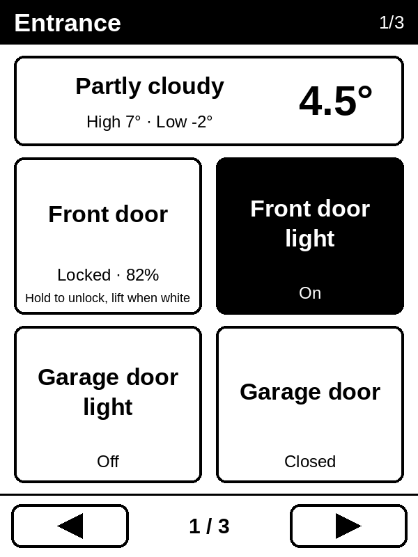
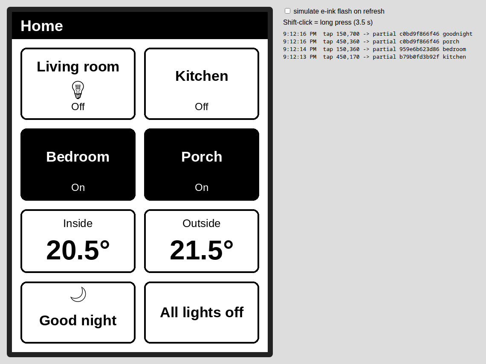

# kobo-hass

A Home Assistant control panel for a Kobo Touch (N905C) e-ink reader. The server
draws the dashboard as a PNG and handles taps; the Kobo only shows images and
reports touch coordinates. See `plan.md` for the full design.

<p align="center">
  
</p>

## Contents

- [Server](#server): run it locally, set the shared secret, or run in Podman or Docker
- [Layout](#layout): buttons, pages, display types, long press, icons
- [Kobo](#kobo): install the client, calibrate touch, use it
- [Development](#development): server endpoints, tests

## Server

```sh
cp config.example.yaml config.yaml   # set the HA URL; set mock: true to try it without HA
cp layout.example.yaml layout.yaml   # buttons, entities and actions
export HA_TOKEN=...                  # long-lived access token from your HA profile
export HADASH_SECRET=$(openssl rand -hex 16)   # shared secret, see below
uv run hadash serve
```

Open http://localhost:8080/?key=<your secret> for the preview (just
http://localhost:8080/ without a secret). Click the screen to simulate taps.
Edits to `layout.yaml` are picked up on the next request.



The log on the right shows each tap's coordinates and the server's reply
(`<refresh> <version> <button>`), which is the same line the Kobo gets.

`uv run hadash --mock render -o out.png` writes a single frame without a server.

### Shared secret

Without a secret, anyone who can reach the server can press its buttons,
including long presses like unlocking a door. That includes any web page opened
in a browser on your network, since a page can make your browser send the request.
So set one:

- On the server, the `HADASH_SECRET` environment variable: at least 16
  characters of `A-Z a-z 0-9 _ -`. `openssl rand -hex 16` makes a good one. The
  server refuses to start with a bad value, and logs a warning when there is none.
- On the Kobo, the same value as `SECRET=` in `hadash.conf`.

With a secret set, every request needs it, as `?key=<secret>` (what the Kobo
sends) or an `X-Hadash-Key` header. Anything else gets `403 error bad-key` and
is logged. If the Kobo's key is wrong, its screen says
"The server rejected this Kobo".

The key travels in plain HTTP, so it keeps out other web pages and devices, not
someone who can watch your Wi-Fi traffic. The server's request log shows it as
`key=***`.

**Adding a secret to a running setup.** Update the Kobo first. A server
without a secret ignores the extra `key=`, so the Kobo keeps working while you
switch over.

1. Make the secret (Podman shown; for Compose, put it in `.env`):
   `openssl rand -hex 16 | tr -d '\n' | podman secret create hadash_secret -`
2. Quit the dashboard on the Kobo. Copy the current `kobo/lib.sh` and
   `kobo/hadash.sh` to it, and add `SECRET=<the secret>` to its `hadash.conf`
   (USB, or over Wi-Fi as in [kobo/README.md](kobo/README.md#updating-over-wi-fi)).
   Read the secret back with
   `podman secret inspect --showsecret --format '{{.SecretData}}' hadash_secret`.
3. Install the unit with the `Secret=` line and restart the server:
   `cp deploy/hadash.container ~/.config/containers/systemd/ && systemctl --user daemon-reload && systemctl --user restart hadash`
4. Check: `curl -s -o /dev/null -w '%{http_code}\n' http://localhost:8090/version`
   says `403`, and the Kobo still updates.

To change the secret later, replace it (`podman secret rm hadash_secret`, then
step 1), update `SECRET` on the Kobo, and restart both.

### Podman Quadlet

The image holds only the code; `config.yaml` and `layout.yaml` stay in the project
folder, which is mounted read-only at `/config` (layout edits still reload live).

```sh
podman build -t localhost/hadash .
openssl rand -hex 16 | tr -d '\n' | podman secret create hadash_secret -
cp deploy/hadash.container ~/.config/containers/systemd/
systemctl --user daemon-reload
systemctl --user start hadash          # listens on :8090
journalctl --user -u hadash -f         # logs
```

The unit passes the Podman secret `hadash_secret` to the container as
`HADASH_SECRET`. To read it back for the Kobo's `hadash.conf`:
`podman secret inspect --showsecret --format '{{.SecretData}}' hadash_secret`.

After changing the Python code, rebuild the image and `systemctl --user restart hadash`.
The container can't resolve `.local` names like `homeassistant.local`. Give Home
Assistant a normal DNS name on your network (a record in your router or local DNS)
and use it in `config.yaml`, or use its IP. If you must keep the `.local` name,
uncomment `AddHost=` in the unit and set the IP there. To start at boot without
logging in, run `loginctl enable-linger $USER` once.

### Docker Compose

`compose.yaml` builds the same image and mounts the project folder at `/config`
the same way. It works with `docker compose` and `podman compose`.

```sh
cp config.example.yaml config.yaml     # then edit, as above
cp layout.example.yaml layout.yaml
echo "HA_TOKEN=..." > .env             # or set homeassistant.token in config.yaml
echo "HADASH_SECRET=$(openssl rand -hex 16)" >> .env
docker compose up -d --build           # listens on :8090
docker compose logs -f                 # logs
```

After changing the Python code, run `docker compose up -d --build` again. The
container always listens on 8090, whatever `server.port` says in `config.yaml`.
If Home Assistant's URL uses a `.local` name, uncomment `extra_hosts` in
`compose.yaml` and set its IP, or put the IP in `config.yaml` instead.

## Layout

Everything on screen comes from `layout.yaml` on the server. The Kobo never sees
it: it shows the PNG the server draws and sends back where you tapped. So you can
change the dashboard without touching the Kobo. Save the file, and the Kobo redraws
on its next poll (every 3 s, `POLL_SECS` in `hadash.conf`). If the file has a mistake, the screen shows
"Dashboard error" and the reason, and the browser preview at
http://localhost:8080/ shows the same thing.

`layout.example.yaml` is a full working example with comments.

### The screen

The screen is 600 x 800 pixels, with (0, 0) at the top left. The black title bar
takes the top 64 px. With more than one page, a page bar with ◀ 1 / 2 ▶ takes
the bottom 90 px.

```
  0 ┌──────────────────────────┐
    │ Home          (title)    │
 64 ├──────────────────────────┤
    │ ┌──────────┐┌──────────┐ │  rect: [x, y, width, height]
    │ │ Living   ││ Kitchen  │ │  e.g. [20, 84, 270, 170] and
    │ └──────────┘└──────────┘ │       [310, 84, 270, 170]
    │          ...             │
710 ├──────────────────────────┤  (page bar, only with 2+ pages)
    │  ◀       1 / 2       ▶   │
800 └──────────────────────────┘
```

Each button has a `rect: [x, y, width, height]`, and a tap anywhere inside it
counts. Nothing stops buttons from overlapping or running off the screen, so
check the preview. Two columns of 270 px with 20 px gutters fill the width. Keep
buttons at least 120 px each way so fingers hit them.

### Pages

A single page uses top-level `title` and `buttons`. For several pages, use
`pages:` instead. Tap the left or right third of the page bar to flip pages
(they wrap around). Button ids must be unique across all pages.

```yaml
pages:
  - title: Lights
    buttons: [...]
  - title: Heating
    buttons: [...]
```

### Buttons

Every button needs an `id` and a `rect`. The other keys are optional:

| Key | Meaning |
|---|---|
| `label` | Text on the button (defaults to the id) |
| `display` | How it looks: `toggle`, `value`, `action` (default), `climate`, `weather` |
| `entity` | The HA entity it shows, e.g. `light.kitchen` |
| `action` | Service called on tap, as `domain.service`, e.g. `light.toggle` |
| `data` | Extra service data. `entity_id` is added from `entity` unless you set it here |
| `long_action`, `long_data` | Called instead when the button is held for `long_ms` (default 3000) |
| `hint` | Small print at the bottom of the card, e.g. `Hold 3 s to unlock` |
| `top_icon`, `icon`, `icon_size` | Emoji or images, see [Icons](#icons) |

Text shrinks to fit the card, down to a minimum size, and long labels wrap onto
two lines.

**`toggle`**: the label, with the state underneath. The card turns black when
the state is one of `on_states` (default `on`, `open`, `unlocked`, `playing`,
`home`, `heat`, `cool`, `heat_cool`, `auto`).
- `state_labels: {"off": Closed, "on": Open}` renames states. Quote `on` and
  `off`, or YAML reads them as true and false.
- `attribute: preset_mode` compares an attribute instead of the state.
- `show_status: false` hides the state line.
- `extra_entity` + `extra_unit` add a second reading after the state, e.g.
  `Locked · 75%` for a lock's battery.

**`value`**: a small label and a big number, such as a temperature.
- `unit: "°"` goes after the number.
- `attribute: current_temperature` shows an attribute instead of the state.

**`action`**: just the label. Use it for scenes and scripts.

**`climate`**: the name and current temperature on the left, and
`[−] target [+]` on the right. Tapping − or + changes the target by `step`
(default: the entity's `target_temp_step`, otherwise 0.5), staying within its
min and max. The card must be at least 390 px wide.
- `presets: [away, home, sleep]` adds a row of preset buttons, and the active
  one is drawn black. The card then needs to be at least 220 px tall.
  `preset_labels: {sleep: Night}` renames them.
- `eco_preset: Energy heat` adds an Eco pill instead. Tapping the name side
  switches between that preset and `normal_preset` (default `none`).
  `eco_label` changes the pill's text.

**`weather`**: today's condition (instead of the label) and the temperature of a
`weather.*` entity. `high_entity` and `low_entity` add a `High 11° · Low 3°`
line from two sensors.

Entities that are `unavailable` or `unknown` are drawn in grey. If Home
Assistant can't be reached, every entity button goes grey and shows `?`.

### Long press

Use a long press for anything you don't want to set off by brushing the screen.
This button locks on a tap and unlocks only after a 3 s hold:

```yaml
- id: door
  rect: [20, 84, 270, 170]
  label: Front door
  entity: lock.front_door
  display: toggle
  on_states: [unlocked]          # black when unlocked
  action: lock.lock
  long_action: lock.unlock
  hint: Hold 3 s to unlock
```

While you hold, the button turns black after 1 s and goes back to normal once
the hold time has passed: that's when to lift. A hold of more than 10 s counts as
a normal tap. Such holds usually come from a missed finger lift, not a real
press.

### Icons

`toggle`, `value` and `action` cards can show an icon in two places. `top_icon`
sits above the label, and `icon` sits between the label and the state (or
below the label on an `action` card). Each one is either:

- **an emoji**, e.g. `"💡"`, drawn with a black-and-white emoji font (Symbola
  in the container, Noto Emoji if you have it). Set `fonts: icon:` in
  `config.yaml` to use another font. Quote emoji in YAML.
- **an image file**: any value ending in `.png`, `.jpg`, `.jpeg`, `.gif`,
  `.bmp` or `.webp`. The path is relative to `layout.yaml`, and the file must
  exist or the layout is rejected. Images are scaled to fit and converted to
  the screen's 16 greys. Dark icons on a transparent or white background work
  best. They're inverted on black cards and greyed out when the entity is
  unavailable.

To change the icon with the state, give a map. `default` covers every other
state (and an action card, which has no state):

```yaml
- id: kitchen
  rect: [310, 84, 270, 170]
  label: Kitchen
  entity: light.kitchen
  action: light.toggle
  display: toggle
  top_icon: icons/kitchen.png
  icon: {"on": "💡", "off": "🌑", default: "❓"}
  icon_size: 40                # px; the default fits the card
```

With both icons on a short card, the label gets squeezed. Make the card taller
or set a smaller `icon_size`. Climate and weather cards don't take icons.

## Kobo

The client is a few BusyBox shell scripts in `kobo/`, plus a FBInk binary to
draw on the screen. Nothing runs on the Kobo besides what ships with it.
`kobo/README.md` has the details and a step-by-step bring-up for debugging.

### What you need

- A Kobo Touch on a recent firmware (tested on 4.38) with Wi-Fi working in
  Nickel. Old firmware can't do modern TLS, so Wi-Fi setup may fail until you
  update.
- [NickelMenu](https://pgaskin.net/NickelMenu/) installed (copy its
  `KoboRoot.tgz` to `.kobo/` and eject; the Kobo reboots to install it).
- An ARM `fbink` built **with image support**. The one bundled with KOReader
  is built without it. `kobo/README.md` shows how to build a static one with Zig.

### Install

1. Connect the Kobo over USB. The drive mounts as `KOBOeReader`.
2. Create `.adds/hadash/` on it and copy the client files there:

   ```sh
   KOBO=/run/media/$USER/KOBOeReader      # wherever it mounted
   mkdir -p $KOBO/.adds/hadash $KOBO/.adds/nm
   cp kobo/hadash.sh kobo/calibrate.sh kobo/lib.sh kobo/touch.awk kobo/calib.awk \
      $KOBO/.adds/hadash/
   cp /path/to/fbink $KOBO/.adds/hadash/
   cp kobo/hadash.conf.example $KOBO/.adds/hadash/hadash.conf
   cp kobo/nm/hadash $KOBO/.adds/nm/hadash
   ```

3. Edit `.adds/hadash/hadash.conf` and set `SERVER` to the server's address,
   e.g. `http://192.168.1.10:8090` for the container (`:8080` for
   `uv run hadash serve`). Use an IP or a normal DNS name; `.local` names
   don't resolve on the Kobo. Set `SECRET` to the server's `HADASH_SECRET`
   (see [Shared secret](#shared-secret)).
4. Eject the Kobo. NickelMenu now has an **HA Dashboard** entry.

### Touch calibration

The touch panel's axes don't match the screen, so taps need mapping. On a
Kobo Touch C (N905C) this is enough; put it in `.adds/hadash/touch.conf`:

```sh
TOUCH_SWAP=1
TOUCH_MIRROR_X=1
```

For other models, run `sh /mnt/onboard/.adds/hadash/calibrate.sh` from a shell
on the Kobo. It asks for taps in three corners and writes `touch.conf`. To get
a shell, add a NickelMenu entry that starts telnet, then `telnet <kobo-ip>`:

```
menu_item :main :Telnet :cmd_spawn :quiet :exec /bin/sh -c "/bin/mount -t devpts devpts /dev/pts 2>/dev/null; /usr/sbin/telnetd -l /bin/sh"
```

Telnet has no password, so remove the entry when you're done.

### Using it

Turn on Wi-Fi in Nickel, then pick **HA Dashboard** from the NickelMenu.
Nickel stops and the dashboard takes over the screen. Press Home (or hold a
finger on the title bar for 1.5 s) to leave; by default the Kobo reboots back
into Nickel (`EXIT_ACTION` in `hadash.conf`). If something goes wrong, the log
is in `/tmp/hadash/log` on the Kobo.

## Development

### Server endpoints

With `HADASH_SECRET` set, every endpoint needs `key=<secret>` in the query (or an
`X-Hadash-Key` header) and answers `403 error bad-key` without it.

| Endpoint | Returns |
|---|---|
| `GET /dashboard.png` | 600x800 greyscale PNG. `?pressed=<id>` draws that button inverted. |
| `GET /version` | Short hash of everything on screen. Poll it and redraw when it changes. |
| `GET /press?x=&y=` | Sent when a finger lands. `long <button-id> <ms>` if that button has a long press, else `none`. |
| `POST /tap?x=&y=&ms=` (GET also works) | Sent on lift; `ms` is how long it was held. One line: `<refresh> <version> [button-id]`. `refresh` is `partial`, `full` (page change) or `none`. |

If HA can't be reached, the dashboard still renders: entity buttons go grey with
`?` and a banner appears at the bottom. A failed action shows a banner for 30 s.

### Tests

```sh
uv run pytest
```

## License

GPL-3.0-or-later. See [LICENSE](LICENSE).
